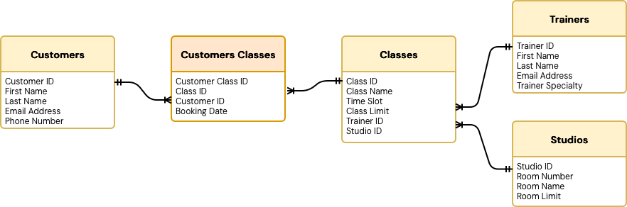
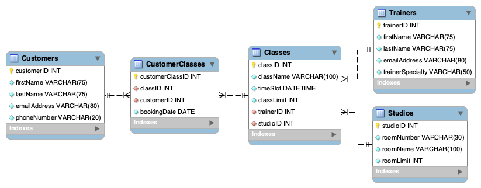

# Workout City Fitness DB — Project Overview

**Team 80:** Aron Wang, Micah Ahn · **Mentor:** Michael L Curry
Created Oct 3, 2026 · Last updated Oct 25, 2026

The full write-up (with feedback appendix) is the team's Project Step 2 Google Doc.
This file keeps the parts the code depends on in sync with the repo.

## Overview
Workout City is a local fitness center that serves about 400 active customers and schedules over 20 weekly fitness classes across 4 studio rooms, generating about $100,000 in annual membership and class revenue. Trainers, studio room assignments, class capacities and enrollments are managed in spreadsheets that aren't connected to each other, which leads to trainer and student over-enrollment and no way to track studio usage.

The database records trainer assignments to classes, schedules classes in studio rooms, manages customer profiles, and tracks customer bookings so classes can't be over-enrolled.

## Database Outline

### Customers
Profile and contact details of individual customers.
- `customerID`: int, auto_increment, unique, NOT NULL, PK
- `firstName`: varchar(75), NOT NULL
- `lastName`: varchar(75), NOT NULL
- `emailAddress`: varchar(80), unique, NOT NULL
- `phoneNumber`: varchar(20), NOT NULL
- **Relationships:** M:N with Classes, implemented through CustomerClasses.

### CustomerClasses (intersection table)
Resolves the M:N between Customers and Classes. Each row is one class enrollment.
- `customerClassID`: int, auto_increment, unique, NOT NULL, PK
- `customerID`: int, NOT NULL, FK → Customers(customerID), ON DELETE CASCADE
- `classID`: int, NOT NULL, FK → Classes(classID), ON DELETE CASCADE
- `bookingDate`: date, NOT NULL
- (`customerID`, `classID`) is UNIQUE, so a customer can't book the same class twice.
- **Relationships:** 1:M Customers → CustomerClasses; 1:M Classes → CustomerClasses.

### Classes
Fitness classes, including timeslot and maximum class size.
- `classID`: int, auto_increment, unique, NOT NULL, PK
- `trainerID`: int, NOT NULL, FK → Trainers(trainerID)
- `className`: varchar(100), NOT NULL
- `timeSlot`: datetime, NOT NULL
- `studioID`: int, NOT NULL, FK → Studios(studioID)
- `classLimit`: int, NOT NULL, default 50
- **Relationships:** 1:M Trainers → Classes; 1:M Studios → Classes; M:N with Customers via CustomerClasses.

### Trainers
Personal and professional details of fitness instructors.
- `trainerID`: int, auto_increment, unique, NOT NULL, PK
- `firstName`: varchar(75), NOT NULL
- `lastName`: varchar(75), NOT NULL
- `emailAddress`: varchar(80), unique, NOT NULL
- `trainerSpecialty`: varchar(50), NOT NULL
- **Relationships:** 1:M with Classes. A trainer leads 0 or more classes; each class has exactly 1 trainer.

### Studios
Physical studio rooms.
- `studioID`: int, auto_increment, unique, NOT NULL, PK
- `roomNumber`: varchar(30), unique, NOT NULL
- `roomName`: varchar(100), NOT NULL
- `roomLimit`: int, NOT NULL
- **Relationships:** 1:M with Classes. A studio hosts many classes; each class is in exactly 1 studio.

## Entity-Relationship Diagram

## Schema

## Sample Data
Loaded by `sql/DDL.sql`: 5 customers, 5 trainers, 4 studios, 5 classes, 5 enrollments.

## Application Output Documentation
TODO: add CLI screenshots/output once the CRUD menu is tested.

## Version History
| Date | Change | Reason / Feedback source |
|------|--------|--------------------------|
| Oct 25, 2026 | Removed bill tracking from problem statement | Peer feedback: not part of the design |
| Oct 25, 2026 | Kept Classes as one table | Peer suggested splitting; kept ERD simple per core requirements |
| Oct 25, 2026 | Aligned all names to camelCase | Peer feedback on naming consistency |
| Oct 31, 2026 | Added UNIQUE (customerID, classID) to CustomerClasses | Matches the candidate key in the normalization notes; blocks double-booking |
